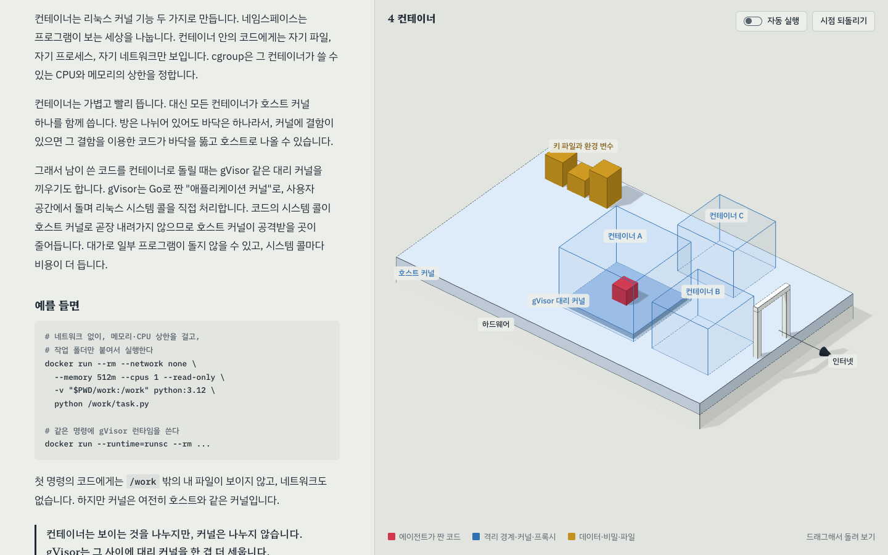
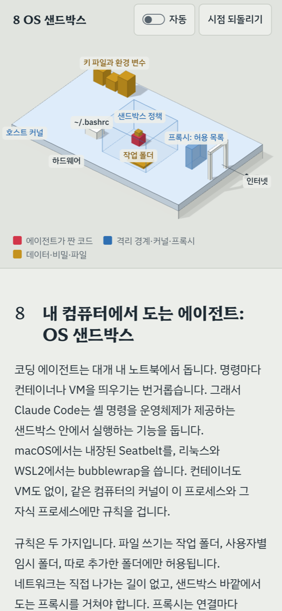

# plz
[English](README.md) | [한국어](README.ko.md) | 日本語 | [简体中文](README.zh-CN.md)

codekongdev が公開している、Claude Code と Codex 向けの AI コーディングエージェント用スキル集です。最初のスキル `plz-3d-explain` は、あらゆる技術的な概念を、操作しながら学べる 3D 学習ページにします。

`plz-<task>` という名前には、エージェントに「この作業をお願い」と頼む意味を込めています。

[ライブデモ](https://codekongdev.github.io/plz/skills/plz-3d-explain/assets/example-agent-sandbox.html) · [インストール](#インストール) · [使い方](#使い方) · [スキル一覧](#スキル一覧)

[](LICENSE) [](https://skills.sh/codekongdev/plz) 

<p align="center">
  <a href="https://codekongdev.github.io/plz/skills/plz-3d-explain/assets/example-agent-sandbox.html"></a>
  
</p>
<p align="center"><em>デスクトップ: 韓国語デモの第 4 章。コンテナはプロセスを分離しますが、ホストのカーネルは共有します。スマートフォン: 第 8 章の OS サンドボックス。英語版のデモは下のスキル一覧にあります。</em></p>

https://github.com/user-attachments/assets/eb09c80d-4260-46b4-ae61-092b9f979167

次のような一文の依頼で始められます。上のデモは、こうしたテーマの一つを扱っています。例は英語ですが、日本語で依頼しても構いません。

```text
Explain how an AI agent code sandbox works in 3D.
```

## インストール

スキルを一つ選んでグローバルにインストールします。

```sh
npx skills add codekongdev/plz --skill plz-3d-explain -g
```

<details>
<summary>Codex</summary>

Codex で使う場合は `-a codex` を指定します。次のコマンドは、現在のプロジェクトの `.agents/skills/` にインストールします。

```sh
npx skills add codekongdev/plz --skill plz-3d-explain -a codex
```

</details>

<details>
<summary>スキルの一覧表示、すべてインストール</summary>

利用できるスキルを一覧表示します。

```sh
npx skills add codekongdev/plz -l
```

すべてのスキルをグローバルにインストールします。

```sh
npx skills add codekongdev/plz --skill '*' -g
```

</details>

<details>
<summary>手動インストール（Claude Code）</summary>

Claude Code に手動でインストールする場合は、リポジトリを clone し、`skills/plz-3d-explain` を `~/.claude/skills/plz-3d-explain` にコピーするか、シンボリックリンクを作成します。コピーする場合のコマンドは次のとおりです。

```sh
git clone https://github.com/codekongdev/plz.git
mkdir -p ~/.claude/skills
cp -R plz/skills/plz-3d-explain ~/.claude/skills/plz-3d-explain
```

</details>

[skills.sh の plz-3d-explain ページ](https://skills.sh/codekongdev/plz/plz-3d-explain)も参照できます。

## 使い方

インストールしたら、普段の言葉でエージェントに頼むだけです。

- 「コンテナの分離がどのように働くのかを 3D で解説して。」
- 「TCP ハンドシェイクの流れを 3D モデルで見せて。」

英語、韓国語、簡体字中国語で依頼することもでき、ページは依頼した言語で作成されます。

## 動作の流れ

ページを依頼すると、`plz-3d-explain` は次の 4 ステップで作業します。

1. **素材の確認。** 題材やリポジトリの内容を確認し、出典と確認日を記録して、未確認の内容はその旨を明示します。
2. **章の設計。** ページで扱う章を設計し、章ごとにモデル上で原因と結果を見せる動作を決めます。
3. **テンプレートへの記入。** テンプレートに文章とシーンを記入します。出力はビルド不要の単一 HTML ファイルです。
4. **ブラウザでの検証。** 完成したページで、コンソールエラー、ラベルの重なりやはみ出し、横方向のスクロール、自動再生、タッチ操作を確認します。

## 対象範囲と動作要件

- **向いていること:** 技術的な概念、仕組み、システム構成を 3D モデルで学ぶこと。
- **対象外:** 静的なアーキテクチャ図やシーケンス図、データのグラフ、Blender によるモデリング、製品のランディングページ、アプリの UI デザイン。
- **ページを開くとき:** three.js r170 と Web フォントを CDN から読み込むため、インターネット接続が必要です。
- **ページを作成するとき:** ローカルサーバーと Playwright などのブラウザ自動化ツールによる検証を含みます。

詳しくは[スキルの README](skills/plz-3d-explain/README.md)を参照してください。

## スキル一覧

| スキル | 作成するもの | デモ |
| --- | --- | --- |
| [plz-3d-explain](skills/plz-3d-explain/README.md) | 技術的な概念やシステム構成を three.js の 3D モデルで学べる、単一 HTML ファイルの学習ページ。 | [コードサンドボックス（英語）](https://codekongdev.github.io/plz/skills/plz-3d-explain/assets/example-agent-sandbox.en.html) · [韓国語](https://codekongdev.github.io/plz/skills/plz-3d-explain/assets/example-agent-sandbox.html) |
| [plz-setup-issues](skills/plz-setup-issues/README.md) | GitHub リポジトリの Issue ラベル、バグ・機能リクエストフォーム、トリアージ規則を設定します。 | — |

## コントリビュート

コントリビュートや翻訳を歓迎します。詳しくは [CONTRIBUTING.md](CONTRIBUTING.md) を参照してください。

## ライセンス

[MIT](LICENSE)。
