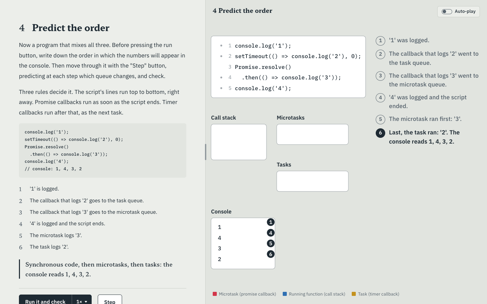

# plz
[English](README.md) | [한국어](README.ko.md) | 日本語 | [简体中文](README.zh-CN.md)

codekongdev が公開している、Claude Code と Codex 向けの AI コーディングエージェント用スキル集です。代表的なスキル `plz-explain` は、技術的な概念を、原因と結果が一歩ずつ再生されるインタラクティブな学習ページにします。章ごとに合った 2D の図か 3D モデルを選んで描きます。

`plz-<task>` という名前には、エージェントに「この作業をお願い」と頼む意味を込めています。

[ライブデモ](https://codekongdev.github.io/plz/skills/plz-explain/assets/example-event-loop.html) · [インストール](#インストール) · [使い方](#使い方) · [スキル一覧](#スキル一覧)

[](LICENSE) [](https://skills.sh/codekongdev/plz) 

<p align="center">
  <a href="https://codekongdev.github.io/plz/skills/plz-explain/assets/example-event-loop.html"></a>
  
</p>
<p align="center"><em>デスクトップ: イベントループのデモの第 4 章。コンソールに出る順番を一歩ずつ予想します。スマートフォン: コードサンドボックスのデモの OS サンドボックスの章、3D モデル。ほかのデモは下のスキル一覧にあります。</em></p>

次のような一文の依頼で始められます。上のデスクトップのデモは、こうしたテーマの一つを扱っています。例は英語ですが、日本語で依頼しても構いません。

```text
Explain how the JavaScript event loop orders callbacks, step by step.
```

## インストール

`npx skills` でインストールするには、**Node.js 22.20 以降**（npm と `npx` を含む）、**Git**、利用する Claude Code または Codex が必要です。まずターミナルで確認してください。

```sh
node --version
npm --version
git --version
```

利用するエージェントに対応するコマンドを実行します。以下は `plz-explain` をグローバルにインストールし、複数のプロジェクトで使えるようにするコマンドです。

Claude Code:

```sh
npx skills add codekongdev/plz --skill plz-explain -a claude-code -g
```

Codex:

```sh
npx skills add codekongdev/plz --skill plz-explain -a codex -g
```

一つのプロジェクトだけにインストールする場合は、そのプロジェクトのディレクトリで上のコマンドから `-g` を外して実行します。Claude Code は `.claude/skills/`、Codex は `.agents/skills/` を使用します。インストーラーが確認を求めたら、案内に従ってください。

利用するエージェントのインストール済みスキルを確認します。

```sh
npx skills list -g -a claude-code
npx skills list -g -a codex
```

対応する一覧に `plz-explain` があればインストールできています。プロジェクトだけにインストールした場合は、同じプロジェクトのディレクトリで一覧コマンドからも `-g` を外してください。

<details>
<summary>スキルの一覧表示、すべてインストール</summary>

利用できるスキルを一覧表示します。

```sh
npx skills add codekongdev/plz -l
```

すべてのスキルをグローバルにインストールします。エージェントの選択を求められたら、利用するツールを選んでください。

```sh
npx skills add codekongdev/plz --skill '*' -g
```

</details>

<details>
<summary>手動インストール（Claude Code）</summary>

Claude Code に手動でインストールする場合は、リポジトリを clone し、`skills/plz-explain` を `~/.claude/skills/plz-explain` にコピーするか、シンボリックリンクを作成します。コピーする場合のコマンドは次のとおりです。

```sh
git clone https://github.com/codekongdev/plz.git
mkdir -p ~/.claude/skills
cp -R plz/skills/plz-explain ~/.claude/skills/plz-explain
```

</details>

[skills.sh の plz-explain ページ](https://skills.sh/codekongdev/plz/plz-explain)も参照できます。

## 使い方

ページを作成するプロジェクトで、エージェントの新しいセッションを開始します。スキルを明示して依頼できます。

- **Claude Code:** `/plz-explain JavaScript のイベントループがコールバックの順番をどう決めるか説明して。`
- **Codex:** `$plz-explain JavaScript のイベントループがコールバックの順番をどう決めるか説明して。`

普段の言葉で依頼することもできます。

- 「JavaScript のイベントループがコールバックの順番をどう決めるか、一歩ずつ見せて。」
- 「コンテナの分離がどのように働くのかを 3D で解説して。」

英語、韓国語、簡体字中国語で依頼することもでき、ページは依頼した言語で作成されます。

スキルが見つからない場合は、上の一覧コマンドでエージェントとインストール範囲を確認し、新しいセッションを開始してください。プロジェクトだけにインストールしたスキルは、そのプロジェクトで使います。`npx` が見つからない場合や Node.js のバージョンエラーが出た場合は、上の要件を確認してください。

## 動作の流れ

ページを依頼すると、`plz-explain` は次の 4 ステップで作業します。

1. **素材の確認。** 題材やリポジトリの内容を確認し、出典と確認日を記録して、未確認の内容はその旨を明示します。
2. **章の設計。** ページで扱う章を設計し、章ごとに形式（ステップ図、時間レーン、コードと状態、パラメーターの遊び場、3D モデルなど）と、原因と結果を見せる動作を決めます。
3. **テンプレートへの記入。** テンプレートに文章とシーンを記入します。出力はビルド不要の単一 HTML ファイルです。
4. **ブラウザでの検証。** 完成したページで、コンソールエラー、ラベルの重なりやはみ出し、横方向のスクロール、自動再生、タッチ操作を確認します。

## 対象範囲と動作要件

- **向いていること:** 技術的な概念、仕組み、システム構成を、一歩ずつ動く 2D の図や 3D モデルで学ぶこと。
- **対象外:** 静的なアーキテクチャ図やシーケンス図、データのグラフ、Blender によるモデリング、製品のランディングページ、アプリの UI デザイン。
- **ページを開くとき:** Web フォントを CDN から読み込み、3D の章があれば three.js r170 も読み込むため、インターネット接続が必要です。
- **ページを作成するとき:** ローカル HTTP サーバー（スキルの例では Python 3）と、エージェントが使える Playwright などのブラウザ自動化ツールが必要です。

スキルのインストールでは Python やブラウザ自動化ツールはインストールされません。ツールがない場合は、検証前にエージェントに準備を依頼してください。HTML が生成されてもブラウザ検証に合格したとは限らないため、結果の報告で実施した検証を確認してください。

詳しくは[スキルの README](skills/plz-explain/README.md)を参照してください。

## スキル一覧

| スキル | 作成するもの | デモ |
| --- | --- | --- |
| [plz-explain](skills/plz-explain/README.md) | 技術的な概念を一歩ずつ再生して見せる、単一 HTML ファイルの学習ページ。章ごとに 2D の図か 3D モデルを選んで描きます。 | [イベントループ（英語）](https://codekongdev.github.io/plz/skills/plz-explain/assets/example-event-loop.en.html) · [韓国語](https://codekongdev.github.io/plz/skills/plz-explain/assets/example-event-loop.html) |
| [plz-3d-explain](skills/plz-3d-explain/README.md) | 3D の章も描ける plz-explain に置き換えられました。今後のリリースで削除されます。 | — |
| [plz-setup-issues](skills/plz-setup-issues/README.md) | GitHub リポジトリの Issue ラベル、バグ・機能リクエストフォーム、トリアージ規則を設定します。 | — |
| [plz-quiz](skills/plz-quiz/README.md) | 資料にもとづくクイズで学習し、理解度を確認して間違いを復習します。 | — |
| [plz-model-sheet](skills/plz-model-sheet/README.md) | キャラクター、動物、NPC、小物向けの、写実的で実寸のモデリング用リファレンスシート（正投影図とターンアラウンド）。 | — |
| [plz-sheet-to-model](skills/plz-sheet-to-model/README.md) | リファレンスシートから Blender をバックグラウンドで実行して作る、実寸でテクスチャ付きの 3D モデル（`.blend` と `.glb`）。 | — |
| [plz-rig-model](skills/plz-rig-model/README.md) | 既存のメッシュモデルに付けるゲーム向けリグ（アーマチュア、スキンウェイト、脚 IK、基本ポーズ、ボーン回転の符号表）。 | — |

### モデリングパイプライン

3 つのスキルが、ゲーム向け 3D モデルを作るパイプラインになっています。順番は [plz-model-sheet](skills/plz-model-sheet/README.md) → [plz-sheet-to-model](skills/plz-sheet-to-model/README.md) → [plz-rig-model](skills/plz-rig-model/README.md) で、どのスキルも単独で使えます。

- **plz-model-sheet** は対象（キャラクター、動物、NPC、小物）を受け取り、実測寸法、オープンライセンスの写真、Codex の画像生成から、実寸の正投影リファレンスシートを作ります。
- **plz-sheet-to-model** はそのシートの各視点の画像と寸法を受け取り、テクスチャ付きの `.blend` と `.glb`（鳥または四足動物の体の構造）と、リギング用の `landmarks.json` を作ります。
- **plz-rig-model** はメッシュモデル（このパイプラインのものでも他のものでもよい `.blend` または `.glb`。リグがすでにあるアバターでもよい）と `landmarks.json` を受け取ってリグを付け、`.glb` と `.blend`、ボーン回転の符号表を書き出します。

API キーが必要なスキルはありません。お使いのマシンで使うツールは次のとおりです。

- **plz-model-sheet:** Python 3（初回実行時にキャッシュ venv へ `pillow` と `numpy` をインストールします）、画像生成が有効でログイン済みの Codex CLI（画像ごとに ChatGPT の利用枠を使います）、`sheet.webp` を描画するヘッドレス Chromium（なければ `sheet.svg` だけが出力されます）、Wikimedia Commons と Wikipedia に接続できるネットワーク。
- **plz-sheet-to-model:** バックグラウンドで実行する Blender 4.2 以降と Python 3（初回実行時にキャッシュ venv へ `pillow` と `numpy` をインストールするため、Python パッケージインデックスに接続できる必要があります）。
- **plz-rig-model:** バックグラウンドで実行する Blender 4.4 以降。追加の Python パッケージもネットワーク接続も不要です。

セットでインストールするには、名前ごとに単体スキルのインストールコマンドを実行します。Claude Code:

```sh
for skill in plz-model-sheet plz-sheet-to-model plz-rig-model; do
  npx skills add codekongdev/plz --skill "$skill" -a claude-code -g
done
```

Codex:

```sh
for skill in plz-model-sheet plz-sheet-to-model plz-rig-model; do
  npx skills add codekongdev/plz --skill "$skill" -a codex -g
done
```

詳細は各スキルの README を参照してください。

## コントリビュート

コントリビュートや翻訳を歓迎します。詳しくは [CONTRIBUTING.md](CONTRIBUTING.md) を参照してください。

## ライセンス

[MIT](LICENSE)。
