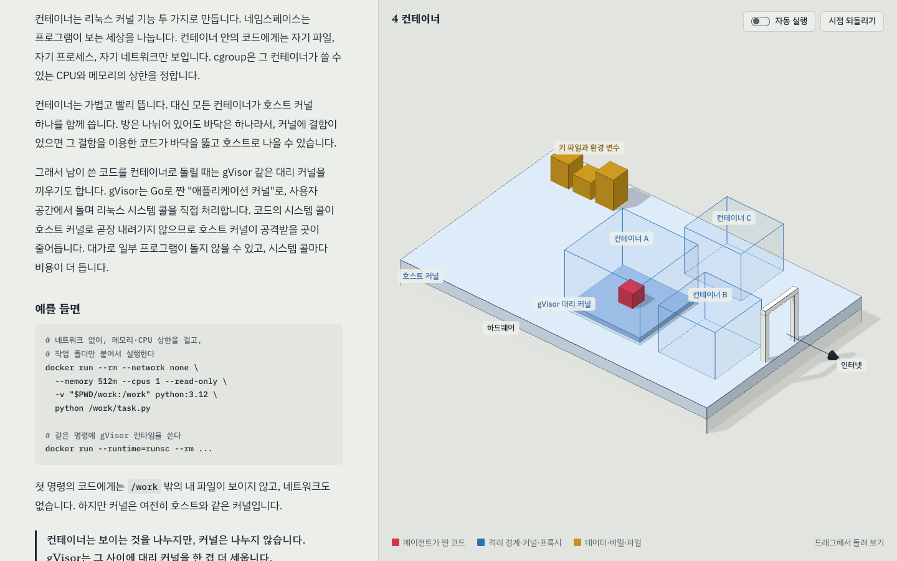
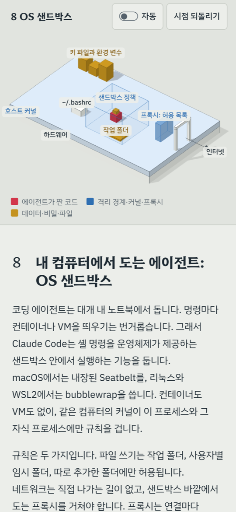

# plz-3d-explain

plz-3d-explain is a skill for AI coding agents such as Claude Code.  
It creates a single HTML learning page with three.js models of technical concepts and system structures.  
Scrolling changes the scene, and chapter buttons play actions that show cause and effect.  
The page includes a mobile layout and loads three.js and fonts from CDNs.

기술 개념과 시스템 구조를 three.js 3D 모형으로 공부하는 단일 HTML 학습 페이지를 만드는 스킬입니다.

만든 사람: codekongdev(코드콩)

시리즈 저장소 첫 화면은 [plz](../../README.md)입니다.

## 미리 보기

[AI 에이전트 코드 샌드박스 데모](https://codekongdev.github.io/plz/skills/plz-3d-explain/assets/example-agent-sandbox.html)를 브라우저에서 바로 열어 볼 수 있습니다. 컨테이너, 마이크로VM, WASM, OS 샌드박스의 격리 방식을 10장으로 설명합니다. [예제 HTML](assets/example-agent-sandbox.html)도 저장소에 있습니다.

데스크톱: 4장 컨테이너



휴대폰: 8장 OS 샌드박스



## 설치

다음 명령으로 설치합니다.

```sh
npx skills add codekongdev/plz --skill plz-3d-explain -g
```

Codex에서 쓰려면 `-a codex`를 붙입니다. 아래 명령은 지금 프로젝트의 `.agents/skills/`에 설치합니다.

```sh
npx skills add codekongdev/plz --skill plz-3d-explain -a codex
```

Claude Code에 수동으로 설치하려면 저장소를 내려받은 뒤 `skills/plz-3d-explain` 폴더를 `~/.claude/skills/plz-3d-explain`에 복사하거나 링크합니다.

```sh
git clone https://github.com/codekongdev/plz.git
cp -R plz/skills/plz-3d-explain ~/.claude/skills/plz-3d-explain
```

## 쓰는 법

에이전트에게 공부할 주제나 살펴볼 저장소를 함께 적어 요청합니다. [SKILL.md](SKILL.md)의 트리거 문구를 쓴 예시입니다.

- “컨테이너와 가상 머신의 차이를 3D로 공부하게 만들어줘.”
- “HTTP 요청이 서버를 거쳐 외부 API로 가는 원리를 모형으로 보여줘.”
- “이 저장소에서 자원이 생성되고 사라지는 과정을 3D 그래픽으로 설명해줘.”

스킬은 내용을 확인하고 장을 나눈 뒤 [템플릿](assets/template.html)에 글과 장면을 채웁니다. 완성한 페이지는 브라우저에서 검증합니다.

## 만들어지는 페이지

- **스크롤에 맞춰 바뀌는 무대.** 데스크톱에서는 왼쪽 글을 읽으면 오른쪽 고정 3D 무대가 현재 장의 장면으로 바뀝니다.
- **버튼으로 보는 원인과 결과.** 장마다 버튼을 눌러 요청이 흐르거나 경계에서 막히는 동작을 재생하고, 결과를 문장으로 확인합니다.
- **자동 실행.** 스위치를 켜면 읽는 장의 동작을 반복 재생합니다. 결과를 보여 준 뒤 처음 상태로 되돌아갑니다. 기본은 꺼져 있으며, 설정은 브라우저에 기억합니다.
- **건축 모형 같은 표현.** 직교 카메라, 흰 모형, 잉크 윤곽선과 옅은 그림자를 씁니다. 빨강은 주인공, 파랑은 경계·규칙·중개자, 황동색은 데이터·자원·재료를 뜻합니다. 드래그로 모형을 돌리고 시점 되돌리기로 처음 시점에 돌아갑니다.
- **휴대폰 레이아웃.** 세로 화면에서는 무대가 위에 붙고 글이 아래에서 스크롤됩니다. 가로 화면에서는 글과 무대를 나란히 놓습니다. 무대의 제목줄과 범례줄은 모형 영역과 나뉩니다.
- **용어와 출처.** 용어를 풀어 쓰고 끝에 정리합니다. 확인한 출처와 확인일을 남기며, 확인하지 못한 내용은 따로 표시합니다.
- **라벨과 화면 검사.** 검증 훅으로 라벨 겹침과 잘림을 검사하고, 장마다 동작이 끝난 화면을 캡처해 모형과 결과 문장이 맞는지 확인합니다. 자동 실행의 반복과 휴대폰 화면도 검사합니다.

## 필요한 것과 한계

결과물은 빌드가 필요 없는 단일 HTML입니다. three.js r170과 웹폰트를 CDN에서 받으므로 페이지를 열 때 인터넷이 필요합니다.

페이지 제작의 검증 단계에서는 로컬 서버와 Playwright 같은 브라우저 자동화 도구를 씁니다. 콘솔 오류, 라벨 겹침·잘림, 가로 스크롤, 자동 실행과 터치 조작을 확인합니다. 검증 방법은 [SKILL.md](SKILL.md), 검증 훅은 [엔진 API](references/engine-api.md), 자주 생기는 문제는 [함정](references/gotchas.md)에 정리돼 있습니다.

휴대폰에서는 모형을 좌우로만 돌립니다. 무대 위를 세로로 쓸면 페이지가 스크롤되고, 가로로 밀면 모형이 돕니다. 위아래 기울이기와 확대는 지원하지 않습니다.

좁은 무대에서는 라벨 위치를 자동으로 조정하지만, 조정 범위를 넘으면 겹침이 남습니다. 라벨을 짧게 쓰고 실제 화면에서 확인해야 합니다.

정적 아키텍처·시퀀스 다이어그램, 데이터 차트, Blender 모델링, 제품 랜딩이나 앱 UI 디자인은 이 스킬의 대상이 아닙니다.

## 개인 설정

설치한 스킬 폴더에서 [개인 설정 견본](references/preferences.example.md)을 복사합니다.

```sh
cp references/preferences.example.md references/preferences.md
```

복사한 파일에 글꼴과 색, 검증 도구, 완성한 HTML의 저장 위치, 받은 피드백 등을 적습니다. 적은 설정은 [SKILL.md](SKILL.md)의 기본값보다 우선하고, 적지 않은 항목은 기본값을 씁니다. 개인 설정 파일은 gitignore 대상입니다.

## 라이선스

[MIT](../../LICENSE).

페이지가 CDN에서 불러오는 외부 자원인 three.js(MIT)와 글꼴 Pretendard·Hahmlet·IBM Plex(SIL OFL)는 저장소에 포함하지 않습니다.
