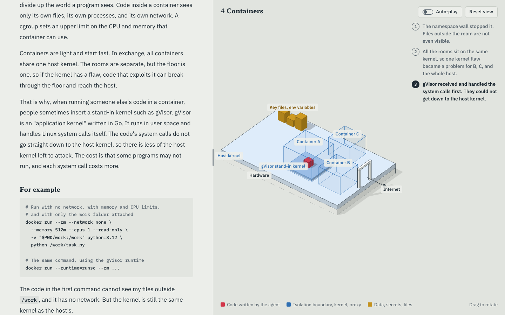
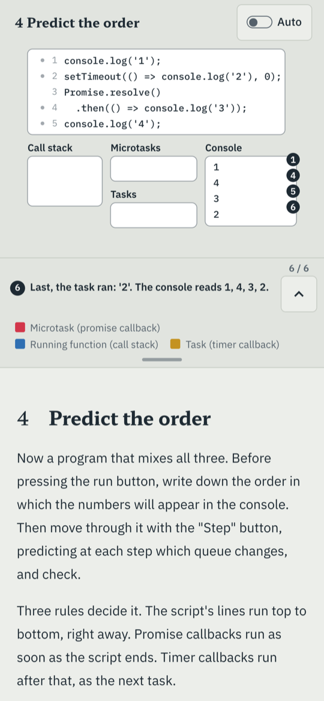

# plz-explain
[English](README.md) | [한국어](README.ko.md) | 日本語 | [简体中文](README.zh-CN.md)

技術的な概念、仕組み、システム構成を学べる、単一 HTML ファイルの学習ページを作成する Claude Code・Codex 向けスキルです。各章で、原因と結果が本文の横のステージに一歩ずつ再生されます。ステージは、その章で学ぶ内容に合わせて 2D の図か 3D のブロックモデルで描きます。

デスクトップ：イベントループの例の第4章、コードとコードが変える状態


デスクトップ：コードサンドボックスの例の第4章、コンテナの 3D モデル



スマートフォン：イベントループの例と、コードサンドボックスの例の OS サンドボックスの章

 

codekongdev による [plz](https://github.com/codekongdev/plz) シリーズのスキルです。すべての章を 3D で描いていた [plz-3d-explain](../plz-3d-explain/README.md) の後継です。

[](https://github.com/codekongdev/plz/blob/main/LICENSE)  

## 例

どの例も、英語または韓国語でブラウザから開けます。HTML ファイルは `assets` フォルダーにもあります。

| 例 | 形式 | デモ |
| --- | --- | --- |
| JavaScript のイベントループ、全5章 | コードと状態、1ステップボタン | [英語](https://codekongdev.github.io/plz/skills/plz-explain/assets/example-event-loop.en.html) · [韓国語](https://codekongdev.github.io/plz/skills/plz-explain/assets/example-event-loop.html) |
| 2つのセッションと1つの行：更新の消失、全5章 | 時間レーン、横並びの比較パネル | [英語](https://codekongdev.github.io/plz/skills/plz-explain/assets/example-lost-update.en.html) · [韓国語](https://codekongdev.github.io/plz/skills/plz-explain/assets/example-lost-update.html) |
| ブルームフィルター、全5章 | ステップ図、パラメーターの遊び場 | [英語](https://codekongdev.github.io/plz/skills/plz-explain/assets/example-bloom-filter.en.html) · [韓国語](https://codekongdev.github.io/plz/skills/plz-explain/assets/example-bloom-filter.html) |
| ハッシュ結合と SIP、全5章 | 演算子ツリー、ステップ図、横並びの比較パネル、ノード列 | [英語](https://codekongdev.github.io/plz/skills/plz-explain/assets/example-hash-join-sip.en.html) · [韓国語](https://codekongdev.github.io/plz/skills/plz-explain/assets/example-hash-join-sip.html) |
| AI エージェントのコードサンドボックス、全10章 | 3D ブロックモデル | [英語](https://codekongdev.github.io/plz/skills/plz-explain/assets/example-agent-sandbox.en.html) · [韓国語](https://codekongdev.github.io/plz/skills/plz-explain/assets/example-agent-sandbox.html) |

## インストール

`npx skills` でインストールするには、Node.js 22.20 以降（npm と `npx` を含む）、Git、利用する Claude Code または Codex が必要です。まずターミナルでツールを確認します。

```sh
node --version
npm --version
git --version
```

利用するエージェントのコマンドを選んでください。`-g` でグローバルにインストールすると、複数のプロジェクトで使えます。

Claude Code:

```sh
npx skills add codekongdev/plz --skill plz-explain -a claude-code -g
```

Codex:

```sh
npx skills add codekongdev/plz --skill plz-explain -a codex -g
```

現在のプロジェクトだけで使う場合は、そのプロジェクトのディレクトリで上記コマンドから `-g` を外して実行します。インストーラーは `.agents/skills/` にスキルを保存し、Claude Code を選んだ場合はリンクも作成します。

利用するエージェントのインストール一覧に `plz-explain` が表示されることを確認します。

```sh
npx skills list -g -a claude-code
npx skills list -g -a codex
```

プロジェクトにインストールした場合は、確認コマンドでも `-g` を外し、同じプロジェクトで実行します。一覧にない場合は、選択したエージェントとインストール範囲を確認してください。一覧にあってもエージェントが認識しない場合は、利用するプロジェクトで新しいエージェントセッションを開始します。

`plz-3d-explain` をインストール済みの場合は、`plz-explain` をインストールした後に削除できます。

```sh
npx skills remove plz-3d-explain -g
```

Claude Code に手動でインストールする場合は、リポジトリを clone し、`skills/plz-explain` を `~/.claude/skills/plz-explain` にコピーするか、シンボリックリンクを作成します。コピーする場合のコマンドは次のとおりです。

```sh
git clone https://github.com/codekongdev/plz.git
mkdir -p ~/.claude/skills
cp -R plz/skills/plz-explain ~/.claude/skills/plz-explain
```

[skills.sh の plz-explain ページ](https://skills.sh/codekongdev/plz/plz-explain)も参照できます。

## 使い方

インストール後、プロジェクトでエージェントを開き、スキルを指定して依頼します。

- Claude Code: `/plz-explain JavaScript のイベントループがコールバックの順番をどう決めるか説明して。`
- Codex: `$plz-explain JavaScript のイベントループがコールバックの順番をどう決めるか説明して。`

[SKILL.md](SKILL.md) の起動フレーズを使い、普段の言葉で依頼することもできます。

- 「ハッシュ結合の仕組みをインタラクティブな解説ページにして。」
- 「2つのトランザクションが同じ行を更新すると何が起きるか、一歩ずつ見せて。」
- 「コンテナと仮想マシンの違いを 3D で説明して。」

英語、韓国語、簡体字中国語でも依頼できます。ページは依頼した言語で作成されます。

スキルは内容を確認して章立てを決め、章ごとに形式を選び、[テンプレート](assets/template.html)に文章とシーンを追加します。完成したページはブラウザで検証します。

## 生成されるページの内容

- **章ごとに選ぶ形式。** エージェントは作成前に、章ごとに5つの問いに答えます。学ぶべき変化があるか、情報がどこにあるか、時間の構造はどうか、各ステップはどんな種類の動きか、章と章をどうつなぐか。その答えで8つの形式から1つを選びます。ステップ図、演算子ツリー、ノード列、横並びの比較パネル、時間レーン、パラメーターの遊び場、コードと状態、3D ブロックモデルです。基本は 2D で、奥行きや包含関係そのものを学ぶ章だけ 3D を使います。[形式の一覧](references/forms.md)を参照してください。
- **スクロールに連動するシーン。** デスクトップでは、左側の文章を読み進めると、右側に固定されたステージが現在の章のシーンに切り替わります。
- **一歩ずつ確かめる原因と結果。** 各章に実行ボタンがあります。押すとステップがステージ上で再生され、番号付きの説明が図の横に表示されます。説明は残るので、最後にすべてのステップを読み返せます。コードの章には1ステップボタンを付けて次のステップを予想してから確かめられ、遊び場の章にはスライダーとプリセットがあります。
- **ルールに沿った動き。** 追う対象は1回の移動に約1秒、同時に動くのは数個まで、結果は原因の直後に起こり、終わった結果はステージに残ります。ルールと根拠は[モーションのルール](references/motion.md)にあります。
- **速度、サイズ調整、自動再生。** 再生速度メニュー（0.5×〜2×）、文章とステージの間のドラッグできる仕切り、現在の章の動作を繰り返すスイッチがあります。自動再生の初期設定はオフで、これらの設定はブラウザに保存されます。動きを減らす設定では、ステップの順序と時間はそのままに、動きだけを省きます。
- **建築模型のような表現。** 白い紙と白いモデル、インク調の輪郭線、意味の決まった3色を使います。赤は動作の主体、青は境界・ルール・仲介役、真鍮色はデータ・リソース・材料です。
- **スマートフォン向けレイアウト。** 縦向きではステージが上部に固定され、その下で文章がスクロールします。横向きでは文章とステージが左右に並びます。
- **用語と出典。** 専門用語を説明し、用語集にもまとめます。確認した出典と確認日を記載し、未確認の内容はその旨を明示します。
- **ページの言語に合わせた表示。** ボタン、案内、タイトルは `<html lang>` に応じて英語・韓国語・日本語・簡体字中国語に切り替わります。ほかの言語はページ内で文言を上書きして追加でき、辞書にない文言は英語で表示されます。本文はユーザーの言語で作成します。
- **ラベルと表示の検証。** 検証用フックでラベルの重なりやはみ出しを調べます。各章の動作完了後のスクリーンショットを説明と照らし合わせ、自動再生の繰り返しやスマートフォン表示も検証します。

## 動作要件と制限

出力はビルド不要の単一 HTML ファイルです。Web フォントを CDN から読み込み、3D の章がある場合は three.js r170 も読み込むため、ページを開く際はインターネット接続が必要です。2D の章だけのページは three.js をダウンロードしません。

検証にはローカル HTTP サーバー（スキルの例では Python 3 を使用）と、エージェントから操作できる Playwright などのブラウザ自動化ツールが必要です。`npx skills` はスキルファイルのみをインストールし、これらのツールはインストールしません。利用できない場合はエージェントに準備を依頼し、実行できなかった検証項目を結果に明記してもらってください。

コンソールエラー、ラベルの重なりやはみ出し、横方向のスクロール、自動再生、遊び場のコントロール、タッチ操作を確認します。手順は [SKILL.md](SKILL.md)、検証用フックは[エンジン API](references/engine-api.md)、よくある問題は[注意点](references/gotchas.md)を参照してください。

バイト配置、多数の主体のシミュレーション、写実的な 3D の機械など、まだ描けない形式もあります。その場合、エージェントは最も近い形式を使い、ページが何を簡略化したかを伝えます。

スマートフォンでは 3D モデルを左右にのみ回転できます。ステージ上を縦にスワイプするとページがスクロールし、横にスワイプするとモデルが回転します。上下への傾き変更やズームには対応していません。

静的なアーキテクチャ図やシーケンス図、データのグラフ、Blender によるモデリング、製品のランディングページ、アプリの UI デザインは対象外です。

## 個人設定

インストール先のスキルディレクトリで、[設定のサンプル](references/preferences.example.md)をコピーします。

```sh
cp references/preferences.example.md references/preferences.md
```

コピーしたファイルに、フォントや色、検証ツール、完成した HTML の保存先、受けたフィードバックなどを記入します。記入した設定は [SKILL.md](SKILL.md) の既定値より優先され、未指定の項目には既定値が使われます。個人設定ファイルは Git の追跡対象から除外されています。

## コントリビュート

コントリビュートや翻訳を歓迎します。詳しくは [CONTRIBUTING.md](https://github.com/codekongdev/plz/blob/main/CONTRIBUTING.md) を参照してください。

## ライセンス

[MIT](https://github.com/codekongdev/plz/blob/main/LICENSE)。

CDN から読み込む外部リソースの three.js（MIT）と、Pretendard・Hahmlet・IBM Plex フォント（SIL OFL）は、このリポジトリには同梱していません。
