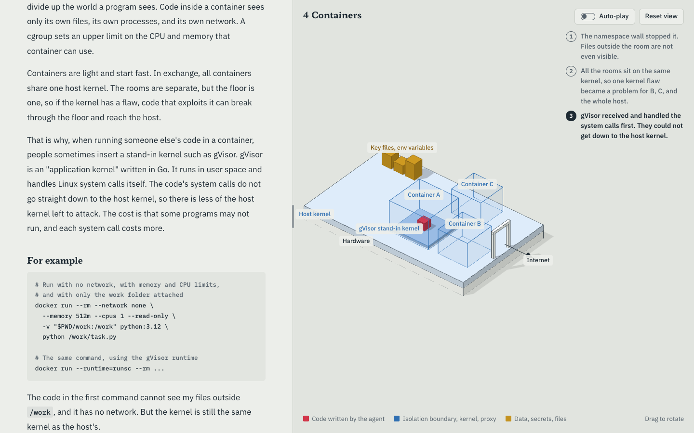
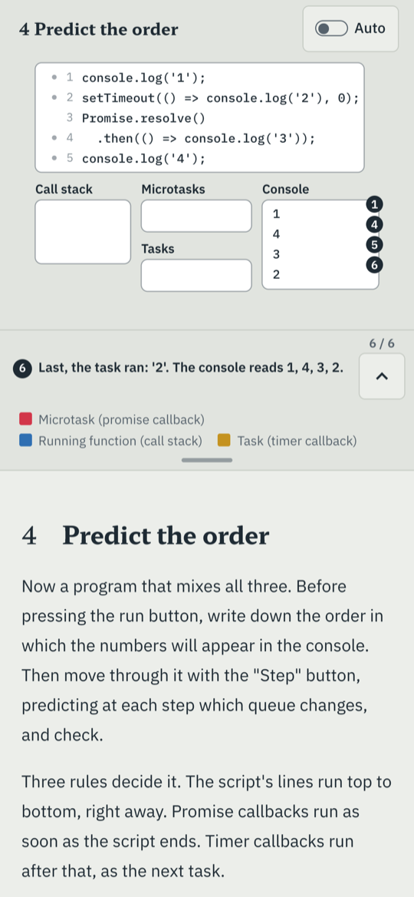
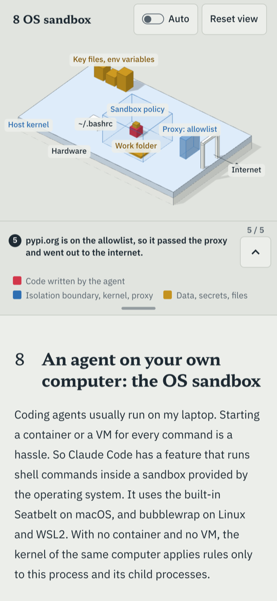

# plz-explain
[English](README.md) | 한국어 | [日本語](README.ja.md) | [简体中文](README.zh-CN.md)

기술 개념, 동작 원리, 시스템 구조를 공부하는 단일 HTML 학습 페이지를 만드는 Claude Code와 Codex용 스킬입니다. 장마다 본문 옆 무대에서 원인과 결과가 단계별로 펼쳐집니다. 무대는 그 장에서 배울 내용에 맞춰 2D 도식이나 3D 블록 모형 중 하나로 그립니다.

데스크톱: 이벤트 루프 예제 4장, 코드와 코드가 바꾸는 상태


데스크톱: 코드 샌드박스 예제 4장, 컨테이너 3D 모형



휴대폰: 이벤트 루프 예제와 코드 샌드박스 예제의 OS 샌드박스 장

 

codekongdev(코드콩)가 만드는 [plz](https://github.com/codekongdev/plz) 시리즈의 스킬입니다. 모든 장을 3D로 그리던 [plz-3d-explain](../plz-3d-explain/README.md)을 대신합니다.

[](https://github.com/codekongdev/plz/blob/main/LICENSE)  

## 예제

예제는 브라우저에서 영어나 한국어로 바로 열어 볼 수 있습니다. HTML 파일은 `assets` 폴더에도 있습니다.

| 예제 | 형식 | 데모 |
| --- | --- | --- |
| JavaScript 이벤트 루프, 5장 | 코드와 상태, 한 단계씩 버튼 | [영어](https://codekongdev.github.io/plz/skills/plz-explain/assets/example-event-loop.en.html) · [한국어](https://codekongdev.github.io/plz/skills/plz-explain/assets/example-event-loop.html) |
| 두 세션, 한 행: 갱신 손실, 5장 | 시간 레인, 나란히 비교 패널 | [영어](https://codekongdev.github.io/plz/skills/plz-explain/assets/example-lost-update.en.html) · [한국어](https://codekongdev.github.io/plz/skills/plz-explain/assets/example-lost-update.html) |
| 블룸 필터, 5장 | 단계 도식, 매개변수 놀이터 | [영어](https://codekongdev.github.io/plz/skills/plz-explain/assets/example-bloom-filter.en.html) · [한국어](https://codekongdev.github.io/plz/skills/plz-explain/assets/example-bloom-filter.html) |
| 해시 조인과 SIP, 5장 | 연산자 트리, 단계 도식, 나란히 비교 패널, 노드 열 | [영어](https://codekongdev.github.io/plz/skills/plz-explain/assets/example-hash-join-sip.en.html) · [한국어](https://codekongdev.github.io/plz/skills/plz-explain/assets/example-hash-join-sip.html) |
| AI 에이전트 코드 샌드박스, 10장 | 3D 블록 모형 | [영어](https://codekongdev.github.io/plz/skills/plz-explain/assets/example-agent-sandbox.en.html) · [한국어](https://codekongdev.github.io/plz/skills/plz-explain/assets/example-agent-sandbox.html) |

## 설치

`npx skills`로 설치하려면 Node.js 22.20 이상(npm과 `npx` 포함), Git, 사용할 Claude Code 또는 Codex가 필요합니다. 먼저 터미널에서 도구를 확인합니다.

```sh
node --version
npm --version
git --version
```

사용할 에이전트의 명령을 선택하세요. `-g`로 전역 설치하면 여러 프로젝트에서 사용할 수 있습니다.

Claude Code:

```sh
npx skills add codekongdev/plz --skill plz-explain -a claude-code -g
```

Codex:

```sh
npx skills add codekongdev/plz --skill plz-explain -a codex -g
```

이 프로젝트에만 설치하려면 프로젝트 디렉터리에서 `-g`를 빼고 같은 명령을 실행합니다. 설치 프로그램은 스킬을 `.agents/skills/`에 저장하고, Claude Code를 선택했다면 Claude Code용 링크를 만듭니다.

사용할 에이전트에서 설치를 확인합니다. 목록에 `plz-explain`이 있어야 합니다.

```sh
npx skills list -g -a claude-code
npx skills list -g -a codex
```

프로젝트에 설치했다면 같은 프로젝트에서 `-g`를 빼고 확인합니다. 스킬이 목록에 없으면 선택한 에이전트와 설치 범위를 확인하세요. 목록에는 있지만 에이전트에서 쓸 수 없다면, 설치한 프로젝트에서 에이전트 세션을 새로 시작합니다.

`plz-3d-explain`을 설치해 두었다면 `plz-explain`을 설치한 뒤 지워도 됩니다.

```sh
npx skills remove plz-3d-explain -g
```

Claude Code에 직접 설치하려면 저장소를 클론한 뒤 `skills/plz-explain`을 `~/.claude/skills/plz-explain`으로 복사하거나 심볼릭 링크를 만듭니다. 복사하는 방법은 다음과 같습니다.

```sh
git clone https://github.com/codekongdev/plz.git
mkdir -p ~/.claude/skills
cp -R plz/skills/plz-explain ~/.claude/skills/plz-explain
```

[skills.sh의 plz-explain](https://skills.sh/codekongdev/plz/plz-explain)도 참고하세요.

## 사용법

설치한 뒤 프로젝트에서 에이전트를 열고 스킬을 직접 호출합니다.

- Claude Code: `/plz-explain JavaScript 이벤트 루프가 콜백 순서를 어떻게 정하는지 설명해 줘.`
- Codex: `$plz-explain JavaScript 이벤트 루프가 콜백 순서를 어떻게 정하는지 설명해 줘.`

[SKILL.md](SKILL.md)의 트리거처럼 평소 말투로 요청해도 됩니다.

- “해시 조인이 어떻게 동작하는지 인터랙티브 설명 페이지로 만들어 줘.”
- “두 트랜잭션이 같은 행을 고칠 때 무슨 일이 일어나는지 단계별로 보여 줘.”
- “컨테이너와 가상 머신의 차이를 3D로 설명해 줘.”

영어, 일본어, 중국어 간체로 요청해도 됩니다. 페이지는 요청한 언어로 작성됩니다.

스킬은 자료를 확인하고, 장을 나눈 뒤 장마다 형식을 고르고, [템플릿](assets/template.html)에 본문과 장면을 채운 다음, 완성한 페이지를 브라우저에서 검증합니다.

## 페이지 구성

- **장마다 고르는 형식.** 에이전트는 만들기 전에 장마다 다섯 가지를 묻습니다. 배울 변화가 있는가, 정보가 어디에 놓여 있는가, 시간 구조는 어떤가, 단계마다 어떤 종류의 움직임인가, 장과 장을 어떻게 잇는가. 그 답으로 여덟 가지 형식 중 하나를 고릅니다. 단계 도식, 연산자 트리, 노드 열, 나란히 비교 패널, 시간 레인, 매개변수 놀이터, 코드와 상태, 3D 블록 모형입니다. 기본은 2D이고, 깊이나 포함 관계 자체를 배울 때만 3D를 씁니다. [형식 목록](references/forms.md)을 참고하세요.
- **본문을 따라가는 장면.** 데스크톱에서 왼쪽 본문을 스크롤하면 오른쪽에 고정된 무대가 현재 장의 장면으로 바뀝니다.
- **단계별로 보는 원인과 결과.** 장마다 실행 버튼이 있습니다. 누르면 단계가 무대에서 펼쳐지고, 번호 붙은 설명이 그림 옆에 나타납니다. 설명은 쌓여서 끝에 모든 단계를 다시 읽을 수 있습니다. 코드 장에는 한 단계씩 버튼을 붙여 다음 단계를 먼저 예측해 볼 수 있고, 놀이터 장에는 슬라이더와 프리셋이 있습니다.
- **규칙이 있는 움직임.** 추적할 대상은 한 번에 약 1초씩 몇 개만 움직이고, 결과는 원인 바로 뒤에 일어나며, 끝난 결과는 무대에 남습니다. 규칙과 근거는 [모션 규칙](references/motion.md)에 있습니다.
- **속도, 크기 조절, 자동 실행.** 재생 속도 메뉴(0.5×~2×), 본문과 무대 사이의 끌어서 움직이는 구분선, 현재 장의 동작을 반복하는 스위치가 있습니다. 자동 실행은 기본으로 꺼져 있고, 브라우저가 이 설정들을 기억합니다. 동작 줄이기 설정에서는 단계 순서와 시간을 그대로 두고 움직임만 끊어서 보여 줍니다.
- **건축 모형 스타일.** 흰 종이와 흰 모형, 잉크 윤곽선, 그리고 의미가 정해진 세 가지 색을 씁니다. 빨강은 행위자, 파랑은 경계, 규칙, 중개자, 황동은 데이터, 자원, 재료입니다.
- **모바일 레이아웃.** 세로 화면에서는 무대가 위에 고정되고 아래에서 본문이 스크롤됩니다. 가로 화면에서는 본문과 무대를 나란히 둡니다.
- **용어와 출처.** 기술 용어를 설명하고 용어집에 모읍니다. 출처와 확인 날짜를 남기고, 확인하지 못한 내용은 표시합니다.
- **언어에 맞춘 화면 문구.** 버튼, 안내, 제목은 페이지의 `<html lang>`에 따라 영어, 한국어, 일본어, 중국어 간체로 나옵니다. 다른 언어는 페이지 안의 문구 재정의로 추가할 수 있고, 빠진 항목은 영어로 나옵니다. 본문은 사용자의 언어로 씁니다.
- **라벨과 화면 검사.** 검증 훅으로 라벨이 겹치거나 잘리지 않았는지 확인합니다. 장마다 끝 상태의 스크린숏을 설명과 대조하고, 자동 실행 반복과 모바일 화면도 확인합니다.

## 요구 사항과 한계

결과물은 빌드 단계가 없는 HTML 파일 하나입니다. 웹 폰트를 CDN에서 불러오고, 3D 장이 있으면 three.js r170도 불러오므로 페이지를 열려면 인터넷 연결이 필요합니다. 2D 장만 있는 페이지는 three.js를 내려받지 않습니다.

검증 단계에는 로컬 HTTP 서버(스킬의 예시는 Python 3를 씁니다)와 에이전트가 쓸 수 있는 브라우저 자동화 도구(예: Playwright)가 필요합니다. `npx skills`는 스킬 파일만 설치하고 이 도구들은 설치하지 않습니다. 도구가 없다면 페이지를 검증하기 전에 준비해 달라고 에이전트에게 요청하고, 실행하지 못한 검사가 있으면 알려 달라고 하세요.

검증 범위는 콘솔 오류, 라벨 겹침과 잘림, 가로 넘침, 자동 실행, 놀이터 컨트롤, 터치 제스처입니다. 절차는 [SKILL.md](SKILL.md), 검증 훅은 [엔진 API](references/engine-api.md), 자주 겪는 문제는 [주의 사항](references/gotchas.md)을 보세요.

바이트 배치, 많은 행위자의 시뮬레이션, 사실적인 3D 기계처럼 아직 그리지 못하는 형식도 있습니다. 그런 경우 에이전트는 가장 가까운 형식을 쓰고, 페이지가 무엇을 단순화했는지 알려 줍니다.

모바일에서 3D 모형은 가로로만 돌아갑니다. 무대 위에서 세로로 밀면 페이지가 스크롤되고, 가로로 밀면 모형이 돌아갑니다. 기울이기와 확대·축소는 지원하지 않습니다.

정적인 아키텍처 다이어그램이나 시퀀스 다이어그램, 데이터 차트, Blender 모델링, 제품 랜딩 페이지, 앱 UI 디자인은 이 스킬의 범위가 아닙니다.

## 개인 설정

설치한 스킬 디렉터리에서 [설정 예시](references/preferences.example.md)를 복사합니다.

```sh
cp references/preferences.example.md references/preferences.md
```

복사한 파일에 글꼴, 색, 검증 도구, 완성한 HTML을 저장할 위치, 피드백을 적습니다. 이 설정은 [SKILL.md](SKILL.md)의 기본값보다 우선하고, 적지 않은 항목은 기본값을 따릅니다. 개인 설정 파일은 Git에서 무시됩니다.

## 기여

기여와 번역을 환영합니다. [CONTRIBUTING.md](https://github.com/codekongdev/plz/blob/main/CONTRIBUTING.md)를 참고하세요.

## 라이선스

[MIT](https://github.com/codekongdev/plz/blob/main/LICENSE).

CDN에서 불러오는 외부 리소스인 three.js(MIT)와 Pretendard, Hahmlet, IBM Plex 글꼴(SIL OFL)은 이 저장소에 포함되어 있지 않습니다.
