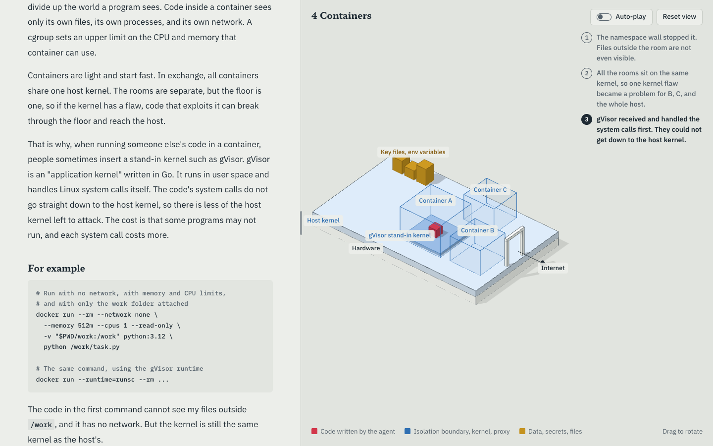
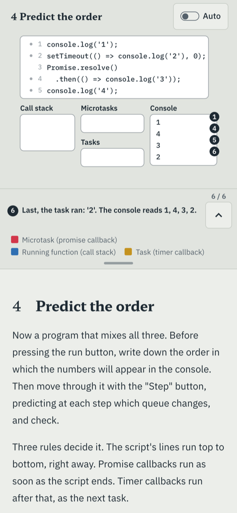

# plz-explain
English | [한국어](README.ko.md) | [日本語](README.ja.md) | [简体中文](README.zh-CN.md)

A skill for Claude Code and Codex that creates a single HTML study page for a technical concept, mechanism, or system structure. Each chapter plays out cause and effect step by step on a stage beside the text: a 2D diagram or a 3D block model, chosen for what the chapter teaches.

Desktop: chapter 4 of the event loop example, code and the state it changes.


Desktop: chapter 4 of the code sandbox example, containers as a 3D model.



Mobile: the event loop example and the OS sandbox chapter of the code sandbox example.

 

This skill is part of [plz](https://github.com/codekongdev/plz), by codekongdev. It replaces [plz-3d-explain](../plz-3d-explain/README.md), which drew every chapter in 3D.

[](https://github.com/codekongdev/plz/blob/main/LICENSE)  

## Examples

Each example opens in the browser, in English or Korean. The HTML files are also in the `assets` folder.

| Example | Forms | Demo |
| --- | --- | --- |
| The JavaScript event loop, 5 chapters | Code and state, with a Step button | [English](https://codekongdev.github.io/plz/skills/plz-explain/assets/example-event-loop.en.html) · [Korean](https://codekongdev.github.io/plz/skills/plz-explain/assets/example-event-loop.html) |
| Two sessions, one row: the lost update, 5 chapters | Lanes, side-by-side panels | [English](https://codekongdev.github.io/plz/skills/plz-explain/assets/example-lost-update.en.html) · [Korean](https://codekongdev.github.io/plz/skills/plz-explain/assets/example-lost-update.html) |
| Bloom filters, 5 chapters | Step diagram, parameter playgrounds | [English](https://codekongdev.github.io/plz/skills/plz-explain/assets/example-bloom-filter.en.html) · [Korean](https://codekongdev.github.io/plz/skills/plz-explain/assets/example-bloom-filter.html) |
| Hash join and SIP, 5 chapters | Operator tree, step diagrams, side-by-side panels, node columns | [English](https://codekongdev.github.io/plz/skills/plz-explain/assets/example-hash-join-sip.en.html) · [Korean](https://codekongdev.github.io/plz/skills/plz-explain/assets/example-hash-join-sip.html) |
| AI agent code sandboxes, 10 chapters | 3D block model | [English](https://codekongdev.github.io/plz/skills/plz-explain/assets/example-agent-sandbox.en.html) · [Korean](https://codekongdev.github.io/plz/skills/plz-explain/assets/example-agent-sandbox.html) |

## Install

To install with `npx skills`, you need Node.js 22.20 or later (with npm and `npx`), Git, and Claude Code or Codex. Check the command-line tools first:

```sh
node --version
npm --version
git --version
```

Choose your agent below. `-g` installs the skill globally, so it is available across projects.

Claude Code:

```sh
npx skills add codekongdev/plz --skill plz-explain -a claude-code -g
```

Codex:

```sh
npx skills add codekongdev/plz --skill plz-explain -a codex -g
```

For this project only, run the matching command from the project directory with `-g` omitted. The installer stores the skill in `.agents/skills/` and links it for Claude Code when selected.

Check the installation for your agent; the list should include `plz-explain`:

```sh
npx skills list -g -a claude-code
npx skills list -g -a codex
```

For a project installation, omit `-g` from the check and run it in the same project. If the skill is missing, check the selected agent and installation scope. If it is listed but unavailable in your agent, start a new agent session from the intended project.

If you have `plz-3d-explain` installed, you can remove it after installing `plz-explain`:

```sh
npx skills remove plz-3d-explain -g
```

For a manual Claude Code installation, clone the repository, then copy or symlink `skills/plz-explain` to `~/.claude/skills/plz-explain`. To copy it:

```sh
git clone https://github.com/codekongdev/plz.git
mkdir -p ~/.claude/skills
cp -R plz/skills/plz-explain ~/.claude/skills/plz-explain
```

See [plz-explain on skills.sh](https://skills.sh/codekongdev/plz/plz-explain).

## Usage

After installing, open your agent in the project and invoke the skill directly:

- Claude Code: `/plz-explain Explain how the JavaScript event loop orders callbacks.`
- Codex: `$plz-explain Explain how the JavaScript event loop orders callbacks.`

You can also ask in plain language, using the triggers in [SKILL.md](SKILL.md):

- “Make an interactive explainer of how a hash join works.”
- “Show step by step what happens when two transactions update the same row.”
- “Explain the difference between containers and virtual machines in 3D.”

You can also ask in Korean, Japanese, or Simplified Chinese; the page is written in the language you ask in.

The skill checks the material, plans the chapters and picks a form for each one, fills the [template](assets/template.html) with text and scenes, and validates the finished page in a browser.

## What the page includes

- **A form chosen per chapter.** Before building, the agent answers five questions for each chapter: is there a change to learn, where does the information live, what is its time structure, what kind of motion is each step, and how do the chapters connect. The answer picks one of eight forms: a step diagram, an operator tree, node columns, side-by-side panels, time lanes, a parameter playground, code and state, or a 3D block model. 2D is the default; 3D is used when depth or containment is the lesson. See [forms](references/forms.md).
- **Scenes that follow the text.** On desktop, scrolling the text on the left changes the fixed stage on the right to the current chapter's scene.
- **Cause and effect, step by step.** Each chapter has a run button. Its steps play on the stage with numbered captions beside the drawing, and the captions stay so you can read every step at the end. Code chapters can add a Step button, so you can predict each step before you see it. Playground chapters have sliders and presets.
- **Motion with rules.** About one second per tracked move, a few objects at a time, the effect right after its cause, and the result left on the stage. The rules and their sources are in [motion](references/motion.md).
- **Speed, resize, and autorun.** A speed menu (0.5× to 2×), a draggable divider between text and stage, and a switch that repeats the current chapter's action. Autorun is off by default, and the browser remembers these settings. Reduced-motion settings keep the step order and timing and cut the movement.
- **An architectural model style.** White paper and models, ink outlines, and three meaning colors: red for the actor, blue for boundaries, rules, and mediators, and brass for data, resources, and materials.
- **A mobile layout.** In portrait, the stage stays at the top while text scrolls below. In landscape, text and stage sit side by side.
- **Terms and sources.** Technical terms are explained and collected in a glossary. Sources and verification dates are recorded, and unverified material is marked.
- **Language-aware interface text.** Buttons, guidance, and titles follow the page's `<html lang>` in English, Korean, Japanese, or Simplified Chinese. Other languages can be added through text overrides in the page; missing entries fall back to English. The page body is written in the user's language.
- **Label and screen checks.** Validation hooks check label overlaps and clipping. Screenshots of each chapter's final state are checked against its captions, along with autorun loops and mobile views.

## Requirements and limits

The output is a single HTML file with no build step. It loads web fonts from a CDN, and three.js r170 too when the page has a 3D chapter, so opening the page requires an internet connection. A page with only 2D chapters never downloads three.js.

The validation step needs a local HTTP server (the skill uses Python 3 in its example) and a browser automation tool the agent can use, such as Playwright. `npx skills` installs the skill files; it does not install these tools. If they are unavailable, ask your agent to prepare them before validating the page and to report any checks it could not run.

Validation covers console errors, overlapping or clipped labels, horizontal overflow, autorun, playground controls, and touch gestures. See [SKILL.md](SKILL.md) for the process, the [engine API](references/engine-api.md) for validation hooks, and [gotchas](references/gotchas.md) for common issues.

Some forms are not drawn yet: byte layouts, simulations of many actors, and realistic 3D machines. For those, the agent uses the nearest form and tells you what the page simplifies.

On mobile, 3D models rotate horizontally only. A vertical swipe over the stage scrolls the page; a horizontal swipe rotates the model. Tilting and zooming are not supported.

Static architecture or sequence diagrams, data charts, Blender modeling, product landing pages, and app UI design are outside this skill's scope.

## Personal settings

From the installed skill directory, copy the [settings example](references/preferences.example.md):

```sh
cp references/preferences.example.md references/preferences.md
```

Use the copied file to record fonts, colors, validation tools, the output location for finished HTML, and feedback. These settings override the defaults in [SKILL.md](SKILL.md); unspecified settings keep their defaults. The personal settings file is ignored by Git.

## Contributing

Contributions and translations are welcome. See [CONTRIBUTING.md](https://github.com/codekongdev/plz/blob/main/CONTRIBUTING.md).

## License

[MIT](https://github.com/codekongdev/plz/blob/main/LICENSE).

The external resources loaded from CDNs—three.js (MIT) and the Pretendard, Hahmlet, and IBM Plex fonts (SIL OFL)—are not bundled in this repository.
