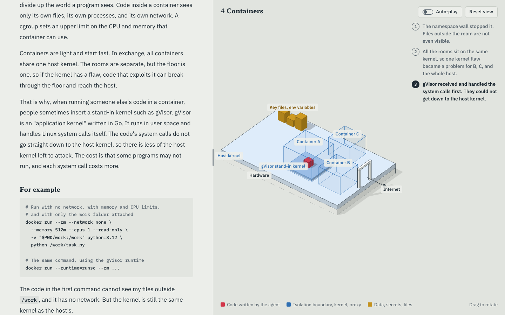
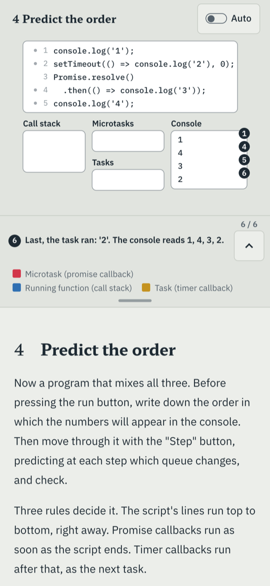

# plz-explain
[English](README.md) | [한국어](README.ko.md) | [日本語](README.ja.md) | 简体中文

一个适用于 Claude Code 和 Codex 的技能，用来生成单个 HTML 学习页面，讲解技术概念、工作原理或系统结构。每一章都会在正文旁的展示区中一步步演示因果关系。展示区按该章要学的内容，选用 2D 图示或 3D 方块模型。

桌面端：事件循环示例第 4 章，代码及其改变的状态


桌面端：代码沙箱示例第 4 章，容器的 3D 模型



手机端：事件循环示例，以及代码沙箱示例中的 OS 沙箱一章

 

这是 codekongdev 的 [plz](https://github.com/codekongdev/plz) 系列技能之一。它取代了把每一章都画成 3D 的 [plz-3d-explain](../plz-3d-explain/README.md)。

[](https://github.com/codekongdev/plz/blob/main/LICENSE)  

## 示例

每个示例都可以在浏览器中用英语或韩语打开。HTML 文件也在 `assets` 文件夹中。

| 示例 | 形式 | 演示 |
| --- | --- | --- |
| JavaScript 事件循环，共 5 章 | 代码与状态，带单步按钮 | [英语](https://codekongdev.github.io/plz/skills/plz-explain/assets/example-event-loop.en.html) · [韩语](https://codekongdev.github.io/plz/skills/plz-explain/assets/example-event-loop.html) |
| 两个会话、一行数据：丢失更新，共 5 章 | 时间泳道、并排对比面板 | [英语](https://codekongdev.github.io/plz/skills/plz-explain/assets/example-lost-update.en.html) · [韩语](https://codekongdev.github.io/plz/skills/plz-explain/assets/example-lost-update.html) |
| 布隆过滤器，共 5 章 | 步骤图、参数游乐场 | [英语](https://codekongdev.github.io/plz/skills/plz-explain/assets/example-bloom-filter.en.html) · [韩语](https://codekongdev.github.io/plz/skills/plz-explain/assets/example-bloom-filter.html) |
| 哈希连接与 SIP，共 5 章 | 算子树、步骤图、并排对比面板、节点列 | [英语](https://codekongdev.github.io/plz/skills/plz-explain/assets/example-hash-join-sip.en.html) · [韩语](https://codekongdev.github.io/plz/skills/plz-explain/assets/example-hash-join-sip.html) |
| AI 代理代码沙箱，共 10 章 | 3D 方块模型 | [英语](https://codekongdev.github.io/plz/skills/plz-explain/assets/example-agent-sandbox.en.html) · [韩语](https://codekongdev.github.io/plz/skills/plz-explain/assets/example-agent-sandbox.html) |

## 安装

使用 `npx skills` 安装时，需要 Node.js 22.20 或更高版本（包含 npm 和 `npx`）、Git，以及要使用的 Claude Code 或 Codex。先在终端确认工具可用：

```sh
node --version
npm --version
git --version
```

选择要使用的代理对应的命令。`-g` 表示全局安装，可在多个项目中使用。

Claude Code:

```sh
npx skills add codekongdev/plz --skill plz-explain -a claude-code -g
```

Codex:

```sh
npx skills add codekongdev/plz --skill plz-explain -a codex -g
```

如果只在当前项目中使用，请在项目目录中运行上述命令并去掉 `-g`。安装工具会将技能保存到 `.agents/skills/`，选择 Claude Code 时还会创建链接。

查看对应代理的已安装技能列表，确认其中包含 `plz-explain`：

```sh
npx skills list -g -a claude-code
npx skills list -g -a codex
```

如果安装在项目中，检查时也要去掉 `-g`，并在同一项目目录中运行。如果列表中没有该技能，请检查选择的代理和安装范围。如果列表中有但代理无法识别，请在目标项目中启动新的代理会话。

如果已经安装了 `plz-3d-explain`，可以在安装 `plz-explain` 之后将其删除：

```sh
npx skills remove plz-3d-explain -g
```

手动安装到 Claude Code 时，先克隆仓库，再将 `skills/plz-explain` 复制或以符号链接的方式放到 `~/.claude/skills/plz-explain`。复制命令如下：

```sh
git clone https://github.com/codekongdev/plz.git
mkdir -p ~/.claude/skills
cp -R plz/skills/plz-explain ~/.claude/skills/plz-explain
```

也可以查看 [skills.sh 上的 plz-explain 页面](https://skills.sh/codekongdev/plz/plz-explain)。

## 使用方法

安装后，在项目中打开代理并直接调用技能：

- Claude Code: `/plz-explain 讲解 JavaScript 事件循环如何决定回调的顺序。`
- Codex: `$plz-explain 讲解 JavaScript 事件循环如何决定回调的顺序。`

也可以参考 [SKILL.md](SKILL.md) 中的触发语，用日常语言提出请求：

- “把哈希连接的工作原理做成交互式讲解页面。”
- “一步步演示两个事务更新同一行时会发生什么。”
- “用 3D 讲解容器和虚拟机的区别。”

也可以用英语、韩语或日语提出请求，页面会使用你提问时的语言编写。

技能会先核对资料，规划章节并为每一章选择形式，再向[模板](assets/template.html)填入正文和场景，最后在浏览器中验证完成的页面。

## 页面包含的内容

- **按章选择的形式。** 动手之前，代理会为每一章回答五个问题：有没有要学的变化，信息位于哪里，时间结构如何，每一步是哪种动作，章与章如何衔接。根据答案从八种形式中选出一种：步骤图、算子树、节点列、并排对比面板、时间泳道、参数游乐场、代码与状态、3D 方块模型。默认使用 2D，只有当深度或包含关系本身就是要学的内容时才使用 3D。详见[形式目录](references/forms.md)。
- **随正文切换的场景。** 在桌面端，滚动左侧正文时，右侧固定的展示区会切换为当前章节的场景。
- **一步步看清因果关系。** 每章都有一个运行按钮。按下后，步骤会在展示区中依次演示，带编号的说明出现在图旁。说明会保留下来，最后可以回看所有步骤。代码章节可以加上单步按钮，先预测下一步再查看；游乐场章节则提供滑块和预设。
- **有规则的动作。** 被追踪的对象每次移动约 1 秒，同时只移动少数几个，结果紧跟在原因之后发生，完成的结果会留在展示区中。规则及其依据见[动作规则](references/motion.md)。
- **速度、尺寸调整与自动播放。** 提供播放速度菜单（0.5×～2×）、可拖动的正文与展示区分隔线，以及重复播放当前章节动作的开关。自动播放默认关闭，浏览器会记住这些设置。在“减少动态效果”设置下，步骤顺序和时长保持不变，只省去移动动画。
- **建筑模型风格。** 使用白纸和白色模型、墨线轮廓，以及含义固定的三种颜色：红色表示行为主体，蓝色表示边界、规则和中介，黄铜色表示数据、资源和材料。
- **移动端布局。** 竖屏时，展示区固定在顶部，正文在下方滚动；横屏时，正文和展示区左右并排。
- **术语与出处。** 解释专业术语，并汇总到术语表。记录已核对的出处和核对日期，并标明未核实的内容。
- **界面文案随页面语言切换。** 按钮、提示和标题会根据 `<html lang>` 切换为英语、韩语、日语或简体中文。其他语言可以在页面中通过覆盖文案来添加，词典中缺失的文案会回退到英语。页面正文使用用户的语言编写。
- **标签与画面检查。** 通过验证钩子检查标签是否重叠或超出显示区域。每章动作结束后都会截图，与说明文字核对，同时检查自动播放循环和手机端画面。

## 环境要求与限制

生成结果是单个 HTML 文件，无需构建。页面通过 CDN 加载 Web 字体，有 3D 章节时还会加载 three.js r170，因此打开时需要联网。只有 2D 章节的页面不会下载 three.js。

验证需要本地 HTTP 服务器（技能示例使用 Python 3）以及代理能够操作的浏览器自动化工具，例如 Playwright。`npx skills` 只安装技能文件，不会安装这些工具。如果工具不可用，请让代理先准备工具，并在结果中说明哪些检查未能执行。

验证会检查控制台错误、标签重叠或越界、横向滚动、自动播放、游乐场控件和触摸操作。具体流程见 [SKILL.md](SKILL.md)，验证钩子见[引擎 API](references/engine-api.md)，常见问题见[注意事项](references/gotchas.md)。

有些形式目前还画不出来，例如字节布局、大量行为主体的模拟和写实的 3D 机械。遇到这些情况，代理会使用最接近的形式，并告诉你页面做了哪些简化。

手机端只能左右旋转 3D 模型。在展示区内上下滑动会滚动页面，左右滑动会旋转模型。不支持上下倾斜或缩放。

本技能不适用于静态架构图或时序图、数据图表、Blender 建模、产品落地页或应用 UI 设计。

## 个人设置

在安装后的技能目录中，复制[设置示例](references/preferences.example.md)：

```sh
cp references/preferences.example.md references/preferences.md
```

在复制的文件中记录字体、颜色、验证工具、成品 HTML 的保存位置，以及收到的反馈等。已填写的设置优先于 [SKILL.md](SKILL.md) 中的默认值，未填写的项目继续使用默认值。个人设置文件已被 Git 忽略。

## 参与贡献

欢迎贡献代码和翻译。详情请参阅 [CONTRIBUTING.md](https://github.com/codekongdev/plz/blob/main/CONTRIBUTING.md)。

## 许可证

[MIT](https://github.com/codekongdev/plz/blob/main/LICENSE)。

页面通过 CDN 加载的外部资源不随仓库分发，包括 three.js（MIT）以及 Pretendard、Hahmlet、IBM Plex 字体（SIL OFL）。
